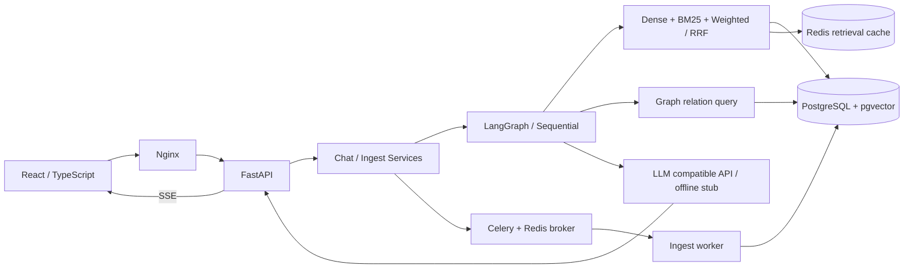

# 架构与关键设计

v2.2 的默认真实模型 Agent 已切换为 LangGraph ReAct 循环，详见 [ReAct机制](ReAct机制.md)。下文的固定路由流程保留为 legacy langgraph / sequential 对照实现；默认路径为模型决策→工具→观察→再次决策→引用生成。

## 请求和数据链路

本地离线模式用 SQLite、内存向量库和本地任务替代外部组件，API 和业务层保持一致。LangGraph 在安装后由 `engine=auto` 选择，也支持显式指定 `langgraph` 或 `sequential`。图谱为关系表 + NetworkX，并未使用 Neo4j；BM25 在进程内计算，并未接入 Elasticsearch。

## 分层职责

| 目录 | 职责 |
| --- | --- |
| `src/mathkb/api` | 请求校验、鉴权、统一错误、SSE 协议 |
| `src/mathkb/services` | 会话与用量保存、上传摄取编排、索引生命周期 |
| `src/mathkb/agent` | 改写、路由、文本/图谱分支、上下文、生成与自检 |
| `src/mathkb/rag` | 分块、embedding、向量库、BM25、融合、精排、缓存 |
| `src/mathkb/llm` | 兼容接口和离线抽取式实现 |
| `src/mathkb/db` | SQLAlchemy 模型、事务、种子导入 |
| `src/mathkb/worker.py` | Celery 应用和 `mathkb.ingest` 任务 |
| `migrations` | Alembic 数据库版本管理 |
| `frontend` | React/TypeScript 界面与 SSE 事件消费 |

## 检索、图谱与引用

1. 文档按章节和句子分块，携带人物、章节、来源等元数据；文档与块需有稳定身份，避免同一人物多篇资料相互覆盖。
2. 稠密向量和 BM25 独立召回，默认对两路分数归一化后加权融合，也支持按名次进行 RRF 融合。可选 Cross-Encoder 在候选集内精排。
3. 人物实体匹配支持人物范围限定；Agent 根据问题选择文本、图谱或两者。图谱支持人物画像、关系路径、领域/籍贯聚合。
4. 上下文提供引用编号，返回来源、章节和摘录；引用自检只检查编号是否越界，不等于逐句事实核验。缺少来源字段的图谱证据仍需后续补充出处。

完整模式使用真实 BGE；离线 hash embedding 只用于确定性样例；BGE 质量应以真实模型评测衡量。置信度是检索启发式提示，没有经过概率校准。人物级 gold 的检索评测不能替代段落证据相关性和答案正确性评估。

## 状态一致性与缓存

文档摄取创建持久化任务记录，记录排队、运行、成功或失败状态。Celery 模式把任务 ID 提交给 worker，业务状态以数据库为准，不能把“成功入队”当成“文档已可检索”。任务失败与重新处理的结果应通过任务列表检查。

文档内容与索引版本共同参与更新判定，避免只比较块数导致同长度内容更新失效。API 与 worker 分开运行时，通过数据库索引版本发现变更，刷新各自的检索状态。Redis 缓存针对检索结果，键包含检索条件和索引版本；文档更新后不应复用旧版本结果。缓存不保存最终生成答案，因此不会跳过新一轮模型调用。

请求中的消融开关应作用于本次请求，避免通过修改共享 retriever 配置造成并发串扰。会话单轮用量单独统计，全局累计仅用于运维汇总；多次请求不应把此前所有 token 再计入本轮。

## 流式与可观测性

SSE 先发送检索事件，再转发兼容模型接口返回的文本增量，结束后发送会话与用量信息。离线 stub 本身没有模型 token 流，只能将抽取结果分段展示，界面明确标注离线状态。代理层关闭 SSE 缓冲，并设置长连接超时。

trace ID 贯穿请求日志和响应头，检索阶段及总请求耗时写入指标。指标和日志用于观察本进程行为；没有宣称已搭建分布式 tracing、Prometheus 服务或监控告警平台。

## 部署与边界

Compose 提供 PostgreSQL 16/pgvector、Redis 7、API、worker、Nginx。API 与 worker 使用同一镜像；API 先执行 Alembic 升级再启动，worker 等 API 健康后启动。默认 worker 并发 1，以便串行演示索引更新，不能据此推导高吞吐能力。

共享 Bearer token 是演示访问控制，没有用户账户、会话 owner、多租户隔离或角色权限。容器只暴露本机 web 端口。要对外服务，还需按目标场景完成身份体系、HTTPS、资源限额、备份与恢复、依赖更新和容量验证。

本机已用真实 PostgreSQL/pgvector、Redis、Celery、BGE 与模型接口完成完整链路联调。Docker 未安装，Compose 容器仍未实际运行。完整证据见 reports/validation.json。
